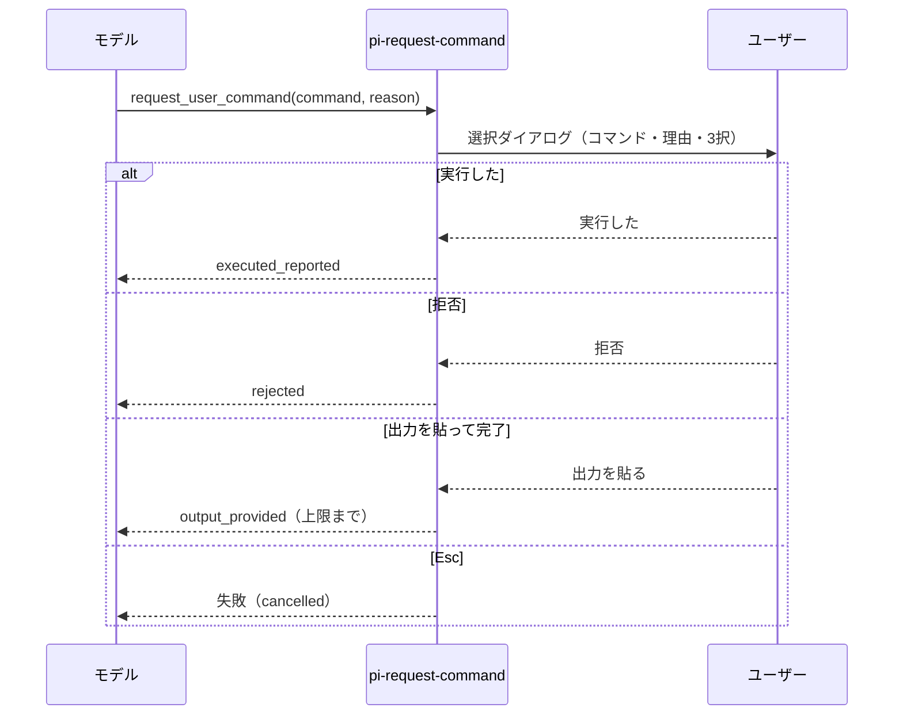

# 設計思想 — pi-request-command

読者は pi-request-command を変更する開発者と AI エージェントです。共通の哲学は [PHILOSOPHY.md](PHILOSOPHY.md)、検証可能な制約と変更手順は [AGENTS.md](AGENTS.md) にあります。

## 目指すべきところ

対象は、Pi でエージェントと作業するユーザーです。目的は、エージェントが権限を必要とする操作を、ユーザーが内容を確認して自分の端末で実行できるようにすることです。エージェントは sudo もパスワードも持たず、コマンドを実行しません。

### 達成状態

| 状態 | 観測方法 |
|---|---|
| 実行すべきコマンドと理由が画面に出る | 選択ダイアログのタイトルに `$ <command>` と `Reason:` が出る |
| ユーザーの選択が結果としてモデルに返る | 「実行した」「拒否」「出力を貼って完了」がそれぞれ固有の `status` で返る |
| 実行の成否をモデルが事実として扱わない | 「実行した」の結果文に「pi は実行していない・結果を検証できない」と書かれる |
| キャンセルは拒否と混同されない | Esc は失敗結果になり、`status` を返さない |
| 権限が拡張に渡らない | 拡張の中に子プロセスを起動する経路がない（`src/` に `child_process` が現れない） |

### 最小の成立条件

| 成立条件 | 達成する状態 |
|---|---|
| `request_user_command` ツール1つ（`exposure: "model-only"`） | 依頼を1回の呼び出しで表せる。codemode から黙って呼ばれない |
| 3択の選択ダイアログと、貼り付け用エディタ | 3つの結果を区別して返せる |
| 非対話モードでは失敗させる | 承認できない環境で、実行されない依頼を依頼として扱わない |

### 非目標

- sudo の実行、パスワードの受け取り、資格情報の保持
- コマンドの自動実行（子プロセスの起動）
- 実行結果の検証（終了コードや出力の自動取得）
- コマンドの妥当性チェック、許可リストの判定
- 承認ゲート（`tool_call` でのブロック）。依頼と実行の分離で足りるため

### 拡張の条件

最小の成立条件を超える機能は、達成状態への寄与を実測で示せるときだけ追加します。例として、出力の自動要約、結果の永続化、コマンドの履歴表示は、この条件を満たすまで追加しません。

## 設計

### 流れ

### 結果

| 選択 | `status` | モデルへの文面の要点 | `truncated` |
|---|---|---|---|
| 実行した | `executed_reported` | 自己申告であり、pi は実行しておらず検証できない | false |
| 拒否 | `rejected` | 効果が起きたと仮定しない | false |
| 出力を貼って完了 | `output_provided` | 貼られた出力の本文を含む | 上限を超えたら true |
| Esc（選択・エディタ両方） | 結果なし（失敗） | ツールは例外を投げる | — |

### 判断

- **キャンセルは失敗にする。** 答えていないのに「拒否」と読まれると、モデルが誤った前提で進むため。
- **空の貼り付けは有効な出力にする。** 何も表示しないコマンドは正常な結果であるため。
- **非対話モードは例外で失敗させる。** 依頼が表示されない環境では、ユーザーが実行できないため。
- **出力は先頭から上限まで残す。** 切り捨ての位置を一つに決め、結果文に明記する。
- **貼り付けの警告はエディタのタイトルに出す。** 出力はモデルのコンテキストに入るため、秘密情報を含むかをユーザーが判断できるようにする。自動マスクはしない。

### 出力の上限

上限は 50 KiB（Pi 本体のツール出力の上限と同じ値）です。計測データがないため暫定値であり、上限値の根拠ではありません。
見直しの材料は、実際の貼り付けの大きさ、上限で切り捨てられた件数、切り捨てで失われた情報の内容です。上限を変えるときは、計測値を `test/unit/tool.test.ts` のコメントに、理由をコミットメッセージに残します。
